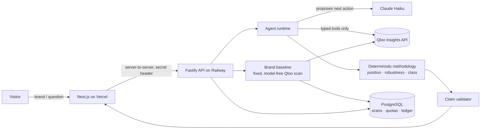

# Cultural Elasticity

**Discover where a brand belongs, and where its cultural relevance starts to break.**

Cultural Elasticity is a cultural research tool. It investigates how far a brand can credibly extend into unfamiliar territory: a new category, audience, experience or partnership. Most tools ask a language model for speculative expansion advice. Cultural Elasticity works differently:

- it gathers real cultural evidence from [Qloo](https://www.qloo.com);
- an AI agent investigates the relationships;
- tested code places the territory relative to Qloo-validated alternatives, and says plainly when the evidence is not enough.

Built for the **Qloo Agentic Hackathon 2026**.

**[▶ Try the live demo](https://cultural-elasticity-raulmermans-projects.vercel.app)**: no sign-up and no key. It runs real Qloo and Claude research within a free evaluation allowance (until 6 November 2026).


---

## The problem

Brands keep moving into new territory: footwear into food, outdoor gear into fashion, luxury into hospitality. Those moves are usually justified by intuition, a mood board, or an LLM answer that sounds confident and cites nothing. Nobody can check *why* a territory is supposed to fit, or how strongly.

## What Cultural Elasticity does

1. **Find a brand.** Qloo resolves the brand name to one cultural entity. If the name is ambiguous, you choose the right one.
2. **See its cultural fingerprint.** A fixed, model-free scan collects what Qloo associates with the brand's audience: artists, places, films, books and taste tags. It draws them as an interactive network.
3. **Pick a direction, or ask your own question.** For example, "How far can Crocs extend into fine dining?"
4. **An agent investigates.** Claude Haiku plans a bounded investigation and calls Qloo tools to:
   - represent the territory;
   - find comparable alternatives that Qloo supports;
   - collect brand-conditioned rankings.
5. **Read a decision-first answer.** The answer comes in three parts:
   - **the outcome**: *Natural fit*, *Credible stretch*, *Cultural break* or *Inconclusive*;
   - **how stable it is**;
   - **what is missing**.

   The full evidence, with its provenance, sits underneath.
6. **Keep it.** You can compare territories, export an HTML or PDF report, and save the research to reopen later.

## Why Qloo matters

Without Qloo there is no measurement. Every number in an outcome comes from Qloo responses, and each keeps the correlation ID of the call it came from.

| Step | What Qloo provides |
| --- | --- |
| Brand identity | Entity resolution (`describe`), with ambiguity surfaced instead of guessed |
| Cultural fingerprint | Taste associations across artists, places, films, books and tags (`recommend`, `entity_tags`) |
| Territory representation | Real entities and tags that stand for "fine dining" or "luxury jewelry" |
| Comparison set | Alternatives that Qloo can resolve, so the comparison is between things Qloo can actually measure |
| Placement | Brand-conditioned rankings within a single call (`rank`); affinities are never compared across calls |

The model never invents a score. It chooses what to investigate and explains results. Deterministic, tested code computes:

- the position;
- the robustness;
- the class.

Each claim the model writes passes a claim validator, or it is replaced by a deterministic template. When Qloo has no support for a hypothesis, the hypothesis is dropped, not analysed as if it were real.

## The outcomes

Every outcome is **relative to the comparison set the agent built for that question**. It is not an absolute prediction of commercial success.

| Outcome | Rule (in [`classification.ts`](backend/src/methodology/classification.ts)) | Plain meaning |
| --- | --- | --- |
| **Natural fit** | Median brand-conditioned percentile ≥ 0.8 | The territory sits close to the brand's observed taste |
| **Credible stretch** | Between the two thresholds | Further from the brand, but with shared taste |
| **Cultural break** | Median percentile ≤ 0.2 | Little shared taste with the brand in this comparison |
| **Representation-sensitive** | Robustness LOW or INSUFFICIENT | The answer changes with the examples chosen, so no class is claimed |
| **Inconclusive / insufficient** | No valid panel, or LOW evidence quality | Qloo did not return enough to place it |

The two uncertainty checks run first. Every outcome is also labelled *provisional* or *steady* according to how it held across exemplars. The thresholds are provisional, and they are published.

## A real research example

Crocs, investigated end to end on the hosted product on 2026-10-29, with live Qloo and live Claude Haiku. Full evidence is in [docs/sprint-9l/LIVE_RELEASE_EVIDENCE.md](docs/sprint-9l/LIVE_RELEASE_EVIDENCE.md).

- **Brand.** Qloo resolved Crocs to entity `454B31CB-594B-4EF3-AF9D-EDC56E89E25E`.
- **Fingerprint.** The baseline returned 10 artists, 10 places, 10 films, 10 books and 14 tags. Five directions were proposed, from *practical-minded individuals* to *Hip Hop*.
- **Crocs → Fiction: Inconclusive.**
  - The agent found three brand-conditioned exemplars (*Welcome to Night Vale*, Max Frei and Trudi Canavan).
  - It found no shared cultural signal and no valid comparison set.
  - So no position is claimed.
- **Crocs → Fine dining: Credible stretch, provisional.**
  - Within the Qloo-validated set {Colorful, fine dining, Relaxed Living}, fine dining placed in the middle, with high representation robustness.
  - Some evidence was not collected because the investigation reached its budget.
  - *We expected a break. Qloo's evidence did not support that, and the result is reported as found.*
- **Cost.** 35 Qloo calls and $0.0215 of model usage for both investigations.

Patagonia was run on 2026-10-29 by an anonymous visitor on desktop and mobile, exactly as a judge would. Evidence is in [docs/sprint-9m/LIVE_EVALUATION_EVIDENCE.md](docs/sprint-9m/LIVE_EVALUATION_EVIDENCE.md).

- **Patagonia → Ethical Consumption: Not settled.** It ranked 1 of 3 against Natural Fibers and Performance Driven, but robustness was low.
- **Patagonia → luxury jewelry, and → nightclubs: Not measured.** Too few Qloo-supported alternatives to form a comparison.

A real **Cultural break** has not been shown in a documented production run yet. We [pre-registered](docs/sprint-9m/CULTURAL_BREAK_PROTOCOL.md) an attempt with fixed candidates and a stopping rule. Both contrasts came back Not measured. The rules were not changed to produce one.

## How the agent works



- **The runtime owns truth; the model proposes.** Haiku picks the next action from the tools that the active skill exposes. The runtime owns state, budgets, retries, validation, sufficiency and stopping. The skills are:
  - `resolve_brand`
  - `resolve_territory`
  - `build_territory_representation`
  - `build_comparison_set`
  - `explore_candidate_territories`
  - `analyze_territories`
- **Qloo through typed tools.** `qloo_resolve_entity`, `qloo_find_tags`, `qloo_get_entity_tags`, `qloo_recommend`, `qloo_related_entities` and rank panels all go through one `QlooClient` (the official `@qloo/qloo-harness`, hackathon host only):
  - calls are spaced 7 seconds apart;
  - a call that fails or times out is never treated as evidence.
- **Bounded probing.** At most 3 empty entity types per concept and 6 per territory. After that the concept is reported as unsupported. A comparison's references are probed in order of observed evidence for the entity type, and after 4 empty reference probes the result is reported as the partial finding it is.
- **Measurement-first feasibility.** Before spending the budget, the runtime states whether a comparison is feasible, uncertain or infeasible, and why. It shows that to the model and records it in the result. A question Qloo's evidence could not answer is never suggested again as if it might be.
- **Representation quality.** A weak territory panel is never forced through to reach a fuller answer. An honest partial result beats a misleading full one.
- **Durable controls.** Brand scans, provider-call reservations, Qloo and model ledgers, and per-visitor quotas live in PostgreSQL, so a restart cannot reset a budget.

The design rules the codebase enforces are in [AGENTS.md](AGENTS.md).

## Features

- **Brand research.** Resolve a brand with Qloo and get its cultural fingerprint as an interactive network.
- **Directions.** Qloo-observed associations worth investigating, kept separate from your own hypotheses.
- **Agent investigations.** Haiku-driven, Qloo-grounded, with live progress.
- **Decision-first readings.** Outcome, stability, evidence strengths, missing evidence and a suggested next question.
- **Comparisons.** Same-brand territories compared without mixing numbers from different Qloo calls.
- **Reports.** Deterministic HTML and PDF exports of the same research.
- **Saved research.** Save, then reopen from the library. A clearly labelled recorded example is available when the live allowance is used up.

## Technical architecture

| Layer | Technology |
| --- | --- |
| Frontend | Next.js 16, React 19, TypeScript; server-side proxy routes only (the browser never sees a key) |
| Backend | Node 22, Fastify 5, zod 4; one replica on Railway |
| Data | PostgreSQL (baseline scans, provider-call reservations, durable budget ledger, quotas) |
| Cultural evidence | Qloo Insights API (hackathon host) via `@qloo/qloo-harness` (MCP) |
| Agent model | Claude Haiku (`claude-haiku-5-5`) via `@anthropic-ai/sdk`: sole production model, no fallback |
| Tests | Vitest (backend), `node:test` (frontend), Playwright (synthetic E2E and hosted acceptance) |

```
frontend/   Next.js app, research workspace, network, reports
backend/    API, Qloo client, agent runtime and skills, methodology, brand baseline
packages/   shared contracts (types used by both sides)
evals/      methodology, agent and query evaluations (synthetic and recorded live)
scripts/    release preflight/verification, secret scan, evaluation open/close
docs/       architecture, methodology, operations, media, development history
```

## Quickstart

You need Node 22.19+, pnpm 10, PostgreSQL 16 (only for brand scans), a [Qloo hackathon API key](https://docs.qloo.com/reference/qloo-llm-hackathon-developer-guide#getting-your-api-key) and, for live investigations, an Anthropic API key.

```sh
git clone https://github.com/RaulMermans/cultural-elasticity.git
cd cultural-elasticity
pnpm install
cp .env.example backend/.env   # set QLOO_API_KEY, QLOO_API_BASE_URL=https://hackathon.api.qloo.com, ANTHROPIC_API_KEY
pnpm dev                       # frontend on http://localhost:3000, backend on http://127.0.0.1:4000
```

For brand scans, set `DATABASE_URL`, `CE_BASELINE_ENABLED=1` and `CE_BASELINE_LIVE_ENABLED=1` in `backend/.env`, then run `pnpm db:migrate`. Every paid admission flag defaults to off. [`.env.example`](.env.example) documents each variable.

The hackathon key works only on `https://hackathon.api.qloo.com`. The backend refuses any other host.

## Evaluation and reliability

```sh
pnpm lint && pnpm typecheck && pnpm test && pnpm build && pnpm check:secrets
pnpm eval:methodology   # offline, synthetic methodology evaluation
pnpm eval:agent         # offline, synthetic agent world (not live-model evidence)
pnpm eval:d2d           # offline Discovery-to-Decision suite: Sprint 9M vs 9N behaviour on identical fixtures
pnpm test:e2e           # browser tests against a synthetic job API
```

- More than 900 backend and 100 frontend unit tests cover:
  - the methodology properties;
  - the claim validator;
  - the probe policy;
  - durable quotas;
  - the release classifier.
- `node scripts/release/verify-production.mjs` checks the deployed Vercel and Railway revisions, readiness, admission state and budgets, and gives one of three verdicts: `RELEASE_VERIFIED`, `RELEASE_DEGRADED` or `RELEASE_FAILED`.
- Hosted acceptance (`frontend/e2e-hosted/acceptance.spec.ts`) drives the real deployment in a browser.
- Live and synthetic results are always reported separately: a synthetic pass is never called a Qloo validation.

## Limitations

- **Relative, not absolute.** An outcome compares a territory with the alternatives built for that question. It does not predict revenue, and it is not an investment recommendation.
- **Provisional thresholds.** The 0.8 and 0.2 percentile cut-offs are published and tested, but not calibrated against commercial outcomes.
- **Qloo coverage.** Some brands and concepts are not resolvable, and some territories return no members. The product then reports *unsupported* or *inconclusive* instead of guessing.
- **Speed.** Calls are spaced to respect Qloo rate limits, so a brand scan takes about a minute and an investigation takes 1–4 minutes.
- **In-process jobs.** Running investigations are held in one backend process; a restart interrupts them, though saved results and durable budgets survive.
- **Bounded public allowance.** The demo shares a capped Qloo and model budget, with small per-visitor quotas. When it is used up, the product says so and offers the recorded example.

## Project history

This repository was built in sprints, with every decision and live run recorded. [docs/README.md](docs/README.md) indexes the methodology, operations and sprint records.

## License

[MIT](LICENSE) © Raul Mermans
