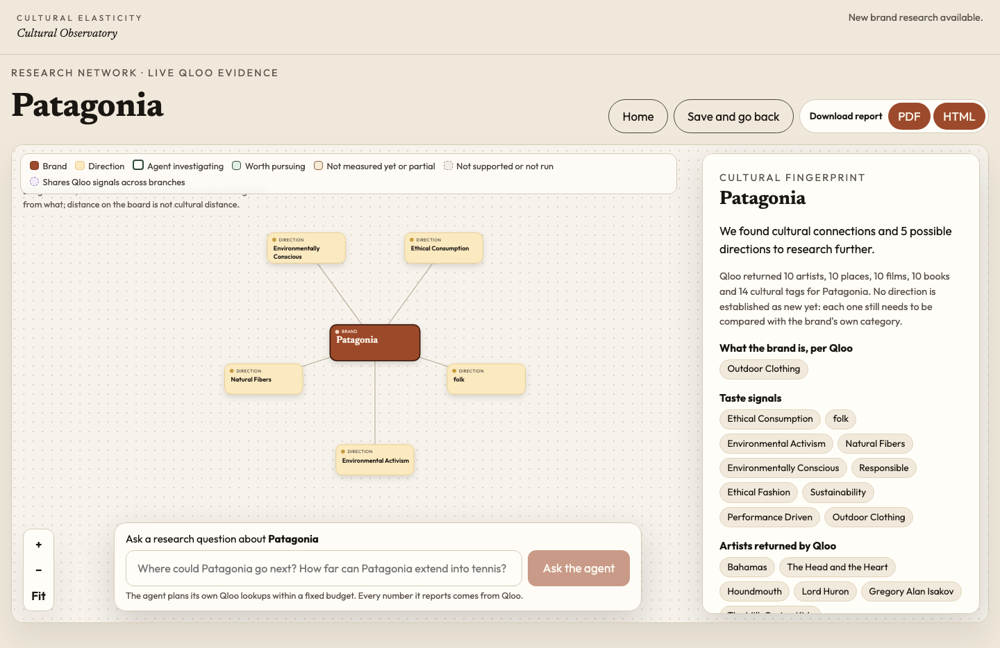
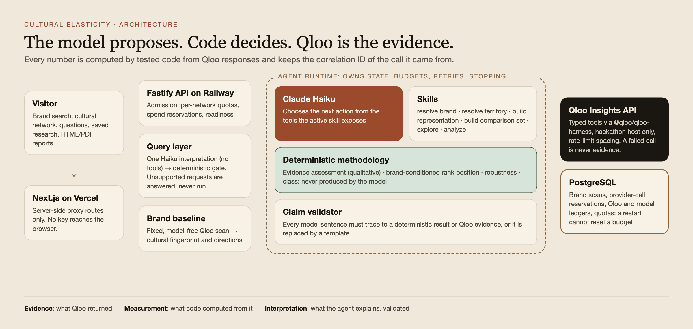
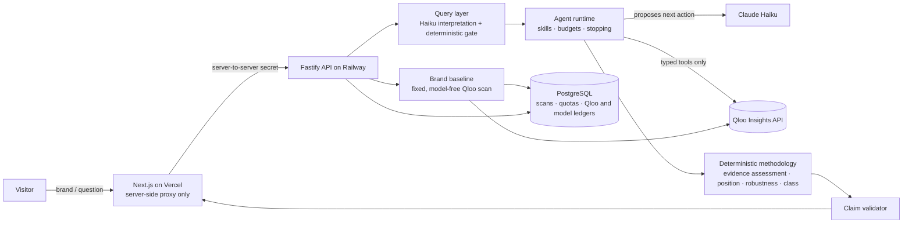

# Cultural Elasticity

**An AI cultural-intelligence researcher that helps brands discover, investigate and evaluate potential cultural directions using real Qloo evidence.**

Built for the **Qloo Agentic Hackathon 2026** · [MIT](LICENSE)

**[▶ Open the live demo](https://cultural-elasticity-raulmermans-projects.vercel.app)**: no sign-up and no key. It runs real Qloo and Claude research within a free public evaluation allowance until 6 November 2026, 05:00 UTC. Two [recorded reports](#judge-ready-examples) open instantly and cost nothing.



---

## Contents

[The problem](#the-problem) · [What it does](#what-it-does) · [Walkthrough](#product-walkthrough) · [What makes it agentic](#what-makes-it-agentic) · [How Qloo is used](#how-qloo-is-used) · [Evidence vs measurement](#evidence-assessment-versus-comparative-measurement) · [Architecture](#architecture) · [Stack](#technology-stack) · [Quickstart](#quickstart) · [Configuration](#environment-configuration) · [Testing](#testing) · [Deployment](#deployment) · [Limitations](#limitations-and-research-validity) · [Docs](#documentation)

## The problem

Brands keep moving into new cultural territory: footwear into food, outdoor gear into fashion, luxury into hospitality. Those moves are usually justified by intuition, a mood board, or an LLM answer that sounds confident and cites nothing. No one can check *why* a territory is supposed to fit, how strongly, or compared with what.

Cultural Elasticity is for the people who make that case: **brand strategists, consumer-insights teams, creative agencies and cultural-research consultancies.** (These are the audiences it was designed for; they have not been validated as paying customers.)

## What it does

1. **Discovers.** Qloo maps the brand's cultural fingerprint: the artists, places, films, books and taste tags its audience is associated with. These often point to directions the brand team would not have looked at, across domains.
2. **Investigates.** You pick a direction or ask a question ("How far can Crocs extend into fine dining?"). A Claude agent plans a bounded investigation and calls Qloo through typed tools.
3. **Evaluates.** Deterministic, tested code turns what Qloo returned into a reading:
   - first, what the evidence shows **directly**;
   - then, when a fair comparison exists, where the territory **places** against Qloo-validated alternatives;
   - finally, what is still **missing**.
4. **Keeps the provenance.** Every number traces back to the Qloo call it came from. You can export an HTML or PDF report, save the research and reopen it later.

It separates **observations** (what Qloo returned) from **strategic hypotheses** (what that could mean), and says so when the evidence is not enough.

## Product walkthrough

| Step | What you see |
| --- | --- |
| **1. Find a brand** | Qloo resolves the name to one entity. If two entities share the name, you choose; the product never guesses. |
| **2. Cultural fingerprint** | A fixed, model-free Qloo scan (about a minute) drawn as an interactive network: the brand, its taste signals and the directions they suggest. Each direction says *why it is here*, with its Qloo evidence. |
| **3. Ask the agent** | Investigate a direction, or type your own question in the composer. The agent's real steps stream into the panel as it works (typically 1–4 minutes). |
| **4. Read the result** | The result leads with its conclusion (for example *Observed association worth examining* or *Limited evidence*), then shows the evidence measurement, the strategic meaning, the comparative result if one exists, and the technical details. |
| **5. Continue or keep it** | Follow up from any branch, compare territories for the same brand, download the PDF or HTML report, or save and reopen it from your library. |

Unsupported requests (for example "What connects Loewe with BLACKPINK?", a bridge between two entities) are answered plainly as *Not run* and **use no investigation allowance**.

## What makes it agentic

The question decides the route. A fixed pipeline cannot know in advance whether "fine dining" should be represented by restaurants, chefs or tags, which alternatives Qloo can actually measure, or when to stop. So a Claude Haiku agent plans the investigation step by step, within a runtime that owns everything that must be true:

- **The model proposes; the runtime decides.** Haiku chooses the next action from the tools that the active skill exposes (`resolve_brand`, `resolve_territory`, `build_territory_representation`, `build_comparison_set`, `explore_candidate_territories`, `analyze_territories`). Code owns state, permissions, budgets, retries, validation, sufficiency and stopping.
- **Different questions take different routes.** Some questions get a direct-evidence answer. Others get a full comparison, or exploration of adjacent territories. A compound question is split into its parts.
- **Bounded, honest probing.** At most 3 empty entity types per concept and 6 per territory. A failed or timed-out Qloo call is never evidence. A weak territory panel is never forced through.
- **No invented numbers.** Every sentence the model writes passes a claim validator, or a deterministic template replaces it.

## How Qloo is used

Without Qloo there is no measurement. Qloo is the evidence, not decoration:

| Step | Qloo provides |
| --- | --- |
| Brand identity | Entity resolution, with ambiguity surfaced instead of guessed |
| Cultural fingerprint | Taste associations across artists, places, films, books and tags (`recommend`, entity tags) |
| Territory representation | Real entities and tags that stand for a territory such as "fine dining" |
| Direct evidence | Brand-conditioned queries: what Qloo associates with the brand *within* the territory |
| Comparison set | Alternative territories that Qloo can actually resolve and measure |
| Placement | Brand-conditioned rank panels within a single call; affinities are never compared across calls |

All Qloo access goes through one `QlooClient` (the official `@qloo/qloo-harness`, pinned to the hackathon host), with calls spaced for rate limits. Every Qloo-derived number keeps the correlation ID of its call.

## Evidence assessment versus comparative measurement

A result answers two different questions, and the product never blurs them.

**1. Evidence assessment: what does Qloo show directly?** This is a qualitative assessment, never a score (`evidence-assessment/v1`, shared by the workspace, the report and the decision card):

| Assessment | Meaning |
| --- | --- |
| Established cultural association | Qloo categorises the brand as the concept, or the concept is on the brand's own Qloo profile *and* a brand-conditioned query returned entities for it |
| Observed association worth examining | One direct observation: the concept is on the brand's profile, or brand-conditioned examples share a cultural signal with the brand beyond the concept itself |
| Limited evidence | Qloo returned something, but not enough to call it an association |
| No support found in the scope tested | Qloo was asked and returned nothing supportive; not proof that no relationship exists |
| Not testable as asked | Qloo has no faithful concept for the question |
| Investigation incomplete | The run stopped before it could conclude |

**2. Comparative measurement: where does it place?** This applies only when a valid comparison set of at least three Qloo-measurable territories exists. Code computes the median brand-conditioned rank percentile across exemplar panels ([`classification.ts`](backend/src/methodology/classification.ts)):

| Outcome | Rule | Plain meaning |
| --- | --- | --- |
| **Natural fit** | median percentile ≥ 0.8 | Close to the brand's observed taste |
| **Credible stretch** | between the thresholds | Further out, with shared taste |
| **Cultural break** | median percentile ≤ 0.2 | Little shared taste in this comparison |
| **Not settled** | robustness LOW or INSUFFICIENT | The answer changes with the examples chosen, so no class is claimed |

Every class is provisional and relative to the comparison the agent built. Separately, each placement is labelled *steady* or *not steady* according to how it held across exemplar sets. Without a valid comparison, the result says **Not established comparatively**; it is never upgraded through copy.

## Judge-ready examples

| | What it shows | How to open |
| --- | --- | --- |
| **Primary: your own brand** | The full live journey | Open the [demo](https://cultural-elasticity-raulmermans-projects.vercel.app), type any well-known consumer brand, then select **Find brand** |
| **Recorded: Crocs** | A measured finding: Crocs → fine dining is a **credible stretch** (ranked 2 of 3 against Colorful and Relaxed Living, steady across example sets), next to fiction, which could not be measured, and why | [Crocs report](https://cultural-elasticity-raulmermans-projects.vercel.app/examples/crocs-2026-10-29.html) |
| **Recorded: Patagonia** | When the evidence does not settle (ethical consumption ranked 1 of 3 with low robustness), and when Qloo has nothing comparable to measure against | [Patagonia report](https://cultural-elasticity-raulmermans-projects.vercel.app/examples/patagonia-2026-10-29.html) |

Both reports were exported from live runs on the hosted product on 29 October 2026, with real Qloo and Claude calls. The Crocs run used 35 Qloo calls and $0.0215 of model usage ([evidence](docs/sprint-9l/LIVE_RELEASE_EVIDENCE.md)); the Patagonia run is documented in the [Sprint 9M evidence](docs/sprint-9m/LIVE_EVALUATION_EVIDENCE.md). They predate the conclusion-first result layout, so their wording differs slightly from today's workspace; their numbers do not change.

## Architecture





- The browser talks only to Next.js routes. Only the backend talks to Qloo or Anthropic, and no key ever reaches the browser.
- A natural-language question is interpreted once by Haiku (no tools), then a deterministic gate decides whether it can run. User text can never authorize tools, budgets or evidence.
- Every number (assessments, ranks, robustness, classes) is computed by tested code in `backend/src/methodology` and `packages/shared`, never by the model.

More detail: [docs/architecture.md](docs/architecture.md). The engineering rules every change follows: [AGENTS.md](AGENTS.md).

## Technology stack

| Layer | Technology |
| --- | --- |
| Frontend | Next.js 16, React 19, TypeScript; server-side proxy routes |
| Backend | Node 22, Fastify 5, zod 4; one replica on Railway |
| Data | PostgreSQL 16: brand scans, provider-call reservations, Qloo and model budget ledgers, per-network quotas |
| Cultural evidence | Qloo Insights API (hackathon host) via `@qloo/qloo-harness` |
| Agent model | Claude Haiku (`claude-haiku-5-5`) via `@anthropic-ai/sdk`; the sole production model, with no fallback |
| Tests | Vitest (backend), `node:test` (frontend), Playwright (synthetic E2E and hosted acceptance) |

```
frontend/   Next.js app: research workspace, network, readings, reports
backend/    API, Qloo client, agent runtime and skills, methodology, brand baseline, durable ledgers
packages/   shared contracts and projections (evidence assessment, decision card)
evals/      methodology, agent, query and discovery evaluations (synthetic and recorded live)
scripts/    release verification, secret scan, public evaluation open/close
docs/       current documentation and the sprint-by-sprint development history
apps/       vercel-feasibility: a Sprint 8 hosting experiment, kept as evidence (not part of the product build)
```

## Quickstart

You need Node 22.19+, pnpm 10, PostgreSQL 16 (for brand scans), a [Qloo hackathon API key](https://docs.qloo.com/reference/qloo-llm-hackathon-developer-guide#getting-your-api-key) and, for live investigations, an Anthropic API key.

```sh
git clone https://github.com/RaulMermans/cultural-elasticity.git
cd cultural-elasticity
pnpm install
cp .env.example backend/.env    # then fill in the values below
pnpm db:migrate                 # needs DATABASE_URL
pnpm dev                        # frontend http://localhost:3000, backend http://127.0.0.1:4000
```

No keys? `pnpm test:e2e` runs the whole product in a browser against a synthetic backend; every screen it shows is labelled synthetic.

## Environment configuration

[`.env.example`](.env.example) documents every variable. The essentials for a local live setup in `backend/.env`:

| Variable | Purpose |
| --- | --- |
| `QLOO_API_KEY` | Qloo key; read only by the backend and the harness child process |
| `QLOO_API_BASE_URL` | Must be `https://hackathon.api.qloo.com`; the backend refuses any other host |
| `ANTHROPIC_API_KEY` | Haiku, for live investigations |
| `DATABASE_URL` | PostgreSQL for brand scans, quotas and ledgers |
| `CE_BASELINE_ENABLED`, `CE_BASELINE_LIVE_ENABLED` | Set both to `1` to allow brand scans |
| `CE_ACCEPT_INVESTIGATIONS` | Set to `1` to allow agent investigations |

Every paid admission flag defaults to **off**.

## Testing

```sh
pnpm lint && pnpm typecheck && pnpm test && pnpm build && pnpm check:secrets
pnpm eval:methodology   # offline methodology evaluation on synthetic evidence
pnpm eval:agent         # offline agent evaluation in a synthetic Qloo world
pnpm eval:query         # offline replay of the query gate (not language-understanding evidence)
pnpm test:e2e           # browser tests against a synthetic job API
```

- 1,064 backend and 119 frontend tests cover the methodology, the claim validator, probe policy, durable quotas and ledgers, report parity and the release classifier.
- `node scripts/release/verify-production.mjs` checks the deployed Vercel and Railway revisions, readiness, admissions and budgets read-only, and prints `RELEASE_VERIFIED`, `RELEASE_DEGRADED` or `RELEASE_FAILED`.
- Synthetic and live results are always reported separately. A synthetic pass is never called a Qloo validation.

## Deployment

| Part | Host | Notes |
| --- | --- | --- |
| Frontend | Vercel, `frontend/` | Builds from `main`. Server-only `BACKEND_URL` and `CE_INTERNAL_API_SECRET` |
| Backend | Railway, `backend/Dockerfile` | Builds from `main`. One replica; PostgreSQL attached |

GitHub `main` is the release source: a merge to `main` deploys both. The public evaluation is bounded by a durable global ceiling (1,000 Qloo calls and $5.00 of model usage), per-network quotas and an expiry, with a kill switch (`scripts/public-evaluation-close.sh`). Release policy: [docs/operations/DEPLOYMENT_RELEASE_CONTRACT.md](docs/operations/DEPLOYMENT_RELEASE_CONTRACT.md).

## Limitations and research validity

- **Relative, not absolute.** A comparative outcome holds only within the comparison set built for that question. Nothing here forecasts sales or demand, and nothing is an investment recommendation.
- **Provisional thresholds.** The 0.8 and 0.2 cut-offs are published and tested, but not calibrated against real brand extensions.
- **Qloo coverage decides what can be answered.** Some concepts have no Qloo representation, and many questions end as *Limited evidence* or *Not established comparatively*. The product reports that rather than guessing.
- **Research value is still modest.** On real questions the agent mostly produces honest partial results and grounded negatives. A real *Cultural break* has not been demonstrated in a documented production run ([pre-registered attempt](docs/sprint-9m/CULTURAL_BREAK_PROTOCOL.md)). No independent human panel has rated the findings.
- **In-process investigations.** Running investigations live in one backend process; a restart interrupts them. Saved research, brand scans, budgets and quotas are durable. Durable agent jobs with journal replay exist and recovered real live runs in Sprint 10D, but are not enabled in production.
- **Speed and allowance.** Rate-limited Qloo calls make a scan take about a minute and an investigation 1–4 minutes. The public demo shares a capped budget; when it is used, the product says so and the recorded reports still open.
- **No LLM-only comparison yet.** We make no measured claim that the Qloo route beats an LLM-only answer.

## Documentation

- [docs/README.md](docs/README.md): current documentation, separated from the development history.
- [docs/submission/](docs/submission/): the Devpost text, demo storyboard and final release review.
- The repository was built in recorded sprints. Each sprint report keeps what was decided, measured and left unverified at the time.

## License and contributions

[MIT](LICENSE) © Raul Mermans. Issues and pull requests are welcome. Every change follows [AGENTS.md](AGENTS.md): no fabricated Qloo evidence, deterministic code owns every number, and no secrets in the repo.
