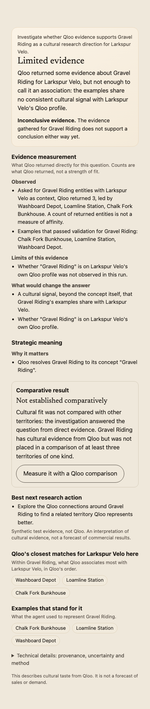
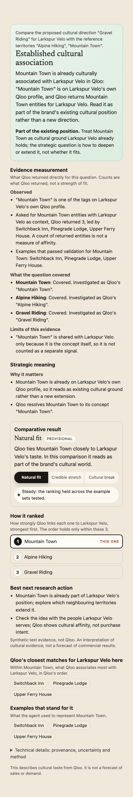
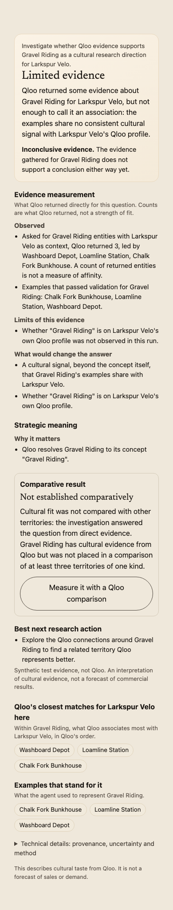
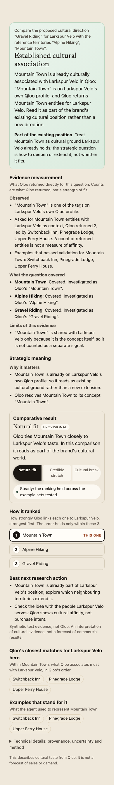

# Sprint 12: Measurement and Research Completion

**Verdict: `ENGINEERING_COMPLETE_OFFLINE`, `LIVE_QLOO_VALIDATION_NOT_RUN`, `LIVE_AGENT_MODEL_VALIDATION_NOT_RUN`, not submission-ready.** See §13 for the five separate verdicts.

## 1. Starting point

| | |
|---|---|
| `main` | `d98d64c` (PR #55, Sprint 11, merged 2026-10-30 13:06Z) |
| Production | Vercel `d98d64c` READY; Railway deployment `d98d64cc…` SUCCESS; `/ready` accepting, public runtime. `verify-production` reports `RELEASE_DEGRADED` only for the known missing Preview `CE_INTERNAL_API_SECRET`, plus Railway metadata not read from the unlinked worktree. |
| Research policy in production | v1 (`CE_RESEARCH_POLICY` unset → v1 for an LLM model) |
| Branch | `sprint/12-measurement-research-completion`, worktree `~/dev/ce-12`. Vercel deployments are disabled for the branch in `frontend/vercel.json`. |

No provider call and no deployment was made in this sprint.

## 2. Evidence used for diagnosis

| Source | Origin | Used for |
|---|---|---|
| `evals/qloo-value/artifacts/*.json`: Rapha, Liquid Death, Aesop, YETI, Le Creuset, Oatly, Allbirds | live Qloo + Haiku, committed in earlier sprints | before/after replay |
| 10D durable session `L2` Bodum × specialty coffee, `L3` Diptyque × boutique hotels / ceramics / jazz, `L4` Dyson × wellness retreats | live, research policy v0, gitignored session dir `~/dev/ce-10d/.../sprint-10d-diagnostic` | trace diagnosis, replay |
| Hosted production run, Vinted × Circular Economy, job `8fbb6070…` (2026-10-30 11:52Z, `c8f3633`, pre-Sprint 11) | live, rendered UI text and screenshot from the hotfix session | diagnosis only (no JSON) |
| Crocs and Patagonia recorded reports (`frontend/public/examples/`) | live-origin exported HTML | diagnosis only (no result JSON) |

**Not available:**

- Production Vinted jobs other than the one rendered output, including Clothing Repair & Upcycling, Space Tourism and Online Marketplace. A read-only query of `agent_jobs` was refused again by this session's permission policy ("Production Reads"), so it was not retried.
- The "40 steps" failure the owner described is therefore **not observed in any trace I could read**. The longest stored run, L3, used 12 turns and 33 tool calls.

No Vinted result is reconstructed or invented.

## 3. Baseline deficiencies (found in the traces)

| # | Deficiency | Evidence |
|---|---|---|
| D1 | Any target without a ranked position was presented as "Not measured yet", even when Qloo had returned brand-conditioned entities, validated exemplars and a concept. Only `single_hypothesis_v1` runs had any direct assessment. | Replay: 8 of 13 stored targets led with "Not measured yet" (§8) |
| D2 | **Tautological shared signal.** The concept's own tag was shown as a signal the territory "shares" with the brand, and `assessSingleHypothesis` counted it as support. | Vinted: "Circular Economy's examples share these Qloo signals with Vinted: Circular Economy." |
| D3 | **Arbitrary comparisons.** The Decision Card's named comparison was the brand's *first two other directions in list order*. `measureQuestion` (the one-click "measure") did the same. Neither checked that they were meaningful alternatives to the question. | `decision-card.ts` `compareNamed`, `research-network.ts` `measureQuestion` |
| D4 | **Wasted reference probing on thin panels.** With one validated exemplar, only the brand's own profile tags can serve as references. The agent probed them anyway, all empty, before `NO_REFERENCE_YIELD`. | L2: 4 empty probes (actor, cookbooks, cooking, based-on-novel) plus 2 refused, about 2 turns. L4: 4 empty probes (female protagonist, self-help, electronic, doctor). |
| D5 | **Compound questions collapse.** Sprint 11 only *disclosed* PARTIAL_COVERAGE; it could not investigate the second part. | Sprint 11 report §18.3 |
| D6 | **The brand's own category was ranked as a stretch.** Vinted × Circular Economy was compared with "Online marketplaces", Vinted's own category. | Vinted rendered output |

## 4. Architecture (unchanged where it should be)

The single-agent hybrid runtime, research policy v1, Qloo integration, methodology (no file under `backend/src/methodology` changed), budgets, provenance and durability are preserved. Sprint 12 adds one deterministic projection and four bounded runtime changes:

```
run state ──finalize──► territory.directEvidence (direct-evidence/v1, facts + correlation IDs)
                                   │
stored result ───────────────► assessResearch()  (packages/shared, evidence-assessment/v1)
                                   │   (same function for runtime, UI, HTML/PDF report, Decision Card, evals)
                                   ▼
                     conclusion · evidence · coverage · comparative status · next actions
```

## 5. Code changes

| Area | Change |
|---|---|
| `packages/shared/src/evidence-assessment.ts` (new) | `assessTerritoryEvidence`, `assessResearch`, `researchAssessmentOf`, `nonTautologicalSignals`, `evidenceAssessmentViolations` |
| `packages/shared/src/agent.ts` | Additive: `DirectEvidenceFacts`, `territory.directEvidence`, `ResearchScope`, `result.researchScope`, `result.evidenceAssessment`, approach `decidedBy: "runtime"` |
| `backend/src/agent/direct-evidence.ts` (new) | Facts per target from run state: brand profile (run profile, or the baseline scan that grounded it), the brand-conditioned query, concept search, exemplar judgments, shared signals without the concept |
| `backend/src/agent/finalizer.ts` | Records `directEvidence` for every target; stores `evidenceAssessment` and `researchScope` |
| `backend/src/agent/hypothesis-assessment.ts` | D2 fix: the concept's own tag no longer counts as a shared signal |
| `backend/src/agent/research-intelligence.ts`, `router.ts`, `state.ts` | `splitCompoundTarget` (D5): one user target per brief concept, investigate approach, budgets unchanged |
| `backend/src/agent/reference-strategy.ts` | `THIN_PANEL_EMPTY_PROBE_LIMIT = 2` (D4) |
| `packages/shared/src/decision-card.ts` | decision-card/v2: `conclusion`, `evidence`, `comparative`; new implications (`ESTABLISHED_POSITIONING`, `NO_SUPPORT_FOUND`, `NOT_TESTABLE_AS_ASKED`); research-question-aware next actions (D3); violation checks for unvalidated names and repeated blocked paths |
| Frontend | New result hierarchy (`TerritoryReading.tsx`, `DecisionCard.tsx`); status pill from the conclusion; `measureQuestion` no longer pairs arbitrary directions; report export with the same sections (`network-report.ts`); CSS in the existing Cultural Observatory tokens |
| Harness | `scripts/eval-research-completion.ts` (offline replay); `durable:live --set s12` (pre-registered live set, §10) |

## 6. The evidence-assessment contract (`evidence-assessment/v1`)

Inputs are only what Qloo returned in this run, or in the baseline scan that grounded the direction, each with its correlation ID. Rules apply in this order:

| Outcome | Rule |
|---|---|
| `INCOMPLETE` | The run did not complete for this target (`NOT_INVESTIGATED`, `BUDGET_EXHAUSTED`) |
| `CONCEPT_NOT_REPRESENTED` | No Qloo concept anchored, **or** the anchored concept is `RELATED_DIFFERENT` / `MISMATCHED`. Evidence about the substitute is never an answer about the requested concept. |
| `ESTABLISHED_ASSOCIATION` | The concept is the brand's own Qloo category tag, **or** it is on the brand's Qloo profile **and** the brand-conditioned query returned entities |
| `OBSERVED_ASSOCIATION` | It is on the brand profile only, **or** the conditioned query returned entities **and** a validated exemplar was not judged a mismatch **and** at least one non-tautological shared signal exists |
| `NO_SUPPORT_IN_TESTED_SCOPE` | The conditioned query answered cleanly with nothing **and** the concept is not on the brand profile. The text always says "not proof that no relationship exists". |
| `LIMITED_EVIDENCE` | Everything else (returned entities without a shared signal, failed or degraded calls, no exemplar) |

Each assessment carries:

- `observed`: lines, each with its correlation IDs;
- `limitations` and `missing` (what would change the answer);
- `comparative` (`MEASURED` / `NOT_MEASURED` / `NOT_ATTEMPTED`), kept separate from the conclusion;
- `rule` and `basis`. `DIRECT_FACTS` means new runs; `DERIVED_FROM_STORED_RESULT` means older results. Shared signals are the brand profile intersected with the exemplar profiles, so the concept tag among them means the concept is on the brand profile.

**Not done:** no score, threshold, class, rank or cross-call comparison is created or changed. A returned-entity count is printed only with "a count of returned entities is not a measure of affinity". NARROWER / PARTIAL_COVERAGE conclusions are scoped to "the part … covers". Partial or degraded profiles can show a tag but never its absence.

## 7. Research-completion behaviour

- **Compound questions.** Under v1, a single user-named `analyze_move` target is split into one target per brief concept. This applies only when every brief concept shares a content word with the user's own territory label. Parts are capped at what the existing 24-call budget can carry (8 calls per part, 2 overhead), so at most 2 parts. Further parts are listed as not investigated, and the card proposes investigating them on their own. The approach becomes `investigate` (`decidedBy: runtime`), because a ranking per part does not fit the same budget. Handoff directions (single grounded tags) are never split.
- **Thin-panel bound.** Once 2 reference probes with fewer than 2 validated exemplars return nothing, and no candidate observed on profiles of the type remains, the reference plan is blocked (`NO_REFERENCE_YIELD`, `LIKELY_REPEATS`). The executor then refuses further probes and the run moves to analysis. On L2 this would have saved 2 of the 4 empty probes and the turn that produced the 2 refusals. That is a counterfactual reading of the trace, not a measured run.
- **Budgets.** Turn and Qloo ceilings are unchanged (12 iterations; 24 / 32 / 32 calls).

## 8. Before and after (offline replay of stored live results)

`OFFLINE_REPLAY_OF_STORED_RESULTS`. Same evidence, production card code from `main` (built shared package of `b74a18d`, identical tree) versus Sprint 12. No provider call. Full output: [evidence/research-completion-replay.md](evidence/research-completion-replay.md).

| | Before | After |
|---|---|---|
| Targets led by "Not measured yet" | **8 of 13** | **0 of 13** |
| Outcomes | — | 12 limited evidence, 1 not testable as asked |
| Card or assessment rule violations | — | 0 |

Representative cases:

- **Aesop × coffee (live, PARTIAL).**
  - Before: "Not measured yet: Coffee has no position relative to other territories."
  - After: "Limited evidence: Qloo returned some evidence about Coffee for Aesop, but not enough to call it an association: the examples share no consistent cultural signal with Aesop's Qloo profile."
  - It also lists the 20 conditioned entities and the two validated exemplars, and what would change the answer: a non-tautological shared signal, and whether "Coffee" is on Aesop's profile.
- **Diptyque × jazz (live, unsupported).**
  - Before: "Not measured yet …" plus "explore connections".
  - After: "Not testable as asked: Qloo has no concept that represents jazz as asked", and the next action is to reframe the concept, not to rerun.
- **Rapha × cycling (live, FULL, not settled).** The comparative result is unchanged ("Not settled (provisional): ranked 3 of 3 …"). It now sits under a direct conclusion and an action to check it against other examples before relying on it.
- **Vinted × Circular Economy (production render, pre-Sprint 11; reconstruction from the rendered text only).**
  - The stored shared signal was the concept itself, so under the derived rule the concept is on Vinted's profile and Qloo returned conditioned entities (Tikamoon, Brabantia, Vestiaire Collective). That reads as **established association**: part of Vinted's existing position.
  - The "Not settled, 1 of 3 against Pre-owned fashion and Online marketplaces" ranking moves to the comparative section.
  - This is a projection of the published text, not a re-run; the job JSON was not readable.

What the replay shows honestly: on these older results the improvement is mostly **framing and completeness**, not new evidence. Every represented target lands in "limited evidence" for two reasons. These runs never recorded brand-profile membership, which new runs record in `directEvidence.brandProfile`. And their filtered shared-signal sets are empty. Whether new live runs produce more established or observed associations is **unmeasured** (§10).

## 9. Synthetic evaluation (offline; never Qloo or model evidence)

| Check | Result |
|---|---|
| `pnpm lint`, `pnpm typecheck`, `pnpm build`, `pnpm check:secrets` | pass |
| `pnpm test`: backend 1,054 tests (adds `agent-sprint12.test.ts`, 13), frontend 118 | pass |
| `pnpm test:e2e`: 64, SYNTHETIC job API; asserts conclusion → evidence → comparative order | pass |
| `pnpm eval:methodology`, `eval:agent`, `eval:query`, `eval:discovery`, `eval:d2d` | pass |
| Property test: every combination of profile × conditioned status × shared signal × mismatch × concept relation | no rule violation; no "no support" when on profile or when the query did not answer cleanly; no card leads with "not measured" |
| Decision card over every committed live result | no violation |

Sprint 12 tests cover:

- each outcome rule;
- saturation not counted as affinity;
- failed and degraded calls not read as absence;
- substitute concepts;
- the tautology fix on older results;
- compound coverage and the split (budget unchanged);
- the no-split guard;
- runtime facts and the stored-equals-recomputed assessment;
- validated-only named comparisons;
- the thin-panel bound on the 9N fixture.

## 10. Live validation plan (requires explicit owner approval)

Run from a **frozen worktree**, local durable worker, local database and private ledger, per the 10D rule. **Never through the public visitor allowance.**

```sh
pnpm durable:live -- --plan --set s12        # prints the plan; no call
pnpm durable:live -- --set s12 --approved-qloo 150 --approved-usd 2.50 \
  --env-file <private env> --database-url postgresql://ce@127.0.0.1:<port>/ce_s12_live --session <dir>
```

| Id | Question (pre-registered) | Expected reading written before the run |
|---|---|---|
| S1 | How well does circular economy fit Vinted as a cultural territory? | established association (concept on Vinted's profile) |
| S2 | Could Vinted credibly move into clothing repair and creative upcycling? | split into two concepts; each assessed separately or listed as not covered |
| S3 | Could Vinted credibly move into space tourism? | not testable as asked, or no support in the tested scope; never a negative fit |
| S4 | Is online marketplace culture a good territory for Vinted? | established association / brand core |
| S5 | Could Diptyque credibly move into ceramics? | limited or observed; never via a material tag (10D rule) |
| S6 | Could Dyson credibly move into wellness retreats? | limited evidence, or adjacent with athleisure judged weak (Sprint 11 rule) |

| Ceiling | Value |
|---|---|
| Worst-case Qloo calls | 144 (6 × 24); approval **150** |
| Haiku reservation | $0.40 per run, one open at a time; $2.40 if none settles; approval **$2.50** |
| Expected spend (10D L2–L4 measured: 12–30 Qloo, $0.009–0.019 per run) | about 80–120 Qloo calls, about $0.06–0.12 |

**Stop conditions.**

- A run starts only if its worst case fits the remaining allowance.
- A Qloo `error` is retried at most once, and only when retryable.
- Unknown outcomes are never replayed.

**Coverage gaps.** S1 to S6 enter through the query path, not the baseline handoff, so the baseline-scan profile observation is not exercised. A handoff case needs a stored scan token, which I do not have.

**Release review.** The owner rates S1 (established), S5 or S6 (adjacent) and S3 (unsupported or weak) from the produced dossiers and exports before any deployment.

## 11. Remaining methodology limitations

1. Live effect unmeasured: no paired v1 vs Sprint 12 run exists.
2. The `OBSERVED_ASSOCIATION` / `ESTABLISHED_ASSOCIATION` thresholds are explicit rules, not calibrated against human judgment. They should be reviewed against the S1–S6 outputs.
3. The brand profile is read at Qloo's fixed take of 20 tags. "Not on the profile" means not among those 20.
4. The compound split relies on the interpreter's brief and a content-word overlap guard. A brief that splits into concepts unrelated in wording is not split (safe, but incomplete).
5. Model synthesis (layer 1 and 2) is not yet given the assessment as input. The UI leads with the deterministic conclusion, and the model write-up stays in the investigation log. They can differ in emphasis, never in numbers (the claim validator is unchanged).
6. The single-hypothesis panel below the reading still shows the Sprint 9 `hypothesisAssessment` wording, which repeats some evidence.
7. The "40 steps" pathology and the other Vinted traces were not inspected (§2).
8. External brand retrieval remains unbuilt (Sprint 11).

## 12. Production readiness and rollback

- Not merged, not deployed. Merging to `main` would auto-deploy Railway and Vercel, so it needs owner review.
- **Rollback:** revert the merge. The new result fields are additive and optional; older stored results render through the derived path. `CE_RESEARCH_POLICY=v0` additionally disables the compound split, since it is v1 only. No migration, environment variable or budget change.

## 13. Verdicts

| Dimension | Verdict |
|---|---|
| Engineering completion | **Complete offline.** All required checks pass (§9). |
| Measurement validity | **Preserved.** Methodology, thresholds, budgets and provenance are unchanged. The new outcomes are rule-based evidence categories with property tests, not metrics. |
| Research usefulness | **Improved framing on stored evidence** (8 → 0 "not measured" leads, concrete "what would change the answer" lines, no arbitrary comparisons). **Substantive usefulness on new runs is unproven.** |
| Live verification | **`LIVE_QLOO_VALIDATION_NOT_RUN`, `LIVE_AGENT_MODEL_VALIDATION_NOT_RUN`.** The plan in §10 awaits approval. |
| Submission readiness | **Not ready.** Acceptance criterion 10 (real, reviewed outputs showing substantially better research) cannot be met without the §10 run and owner review. |

## Screenshots (SYNTHETIC job API, dossier width)

| Unmeasured investigation | Compared territory |
|---|---|
|  |  |
|  |  |

The fictional fixture's "Mountain Town" reads as established only because the synthetic fixture puts its concept tag on the brand profile. These screenshots show layout, not research quality.
