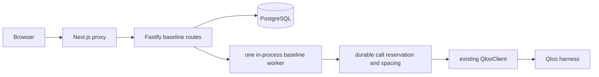
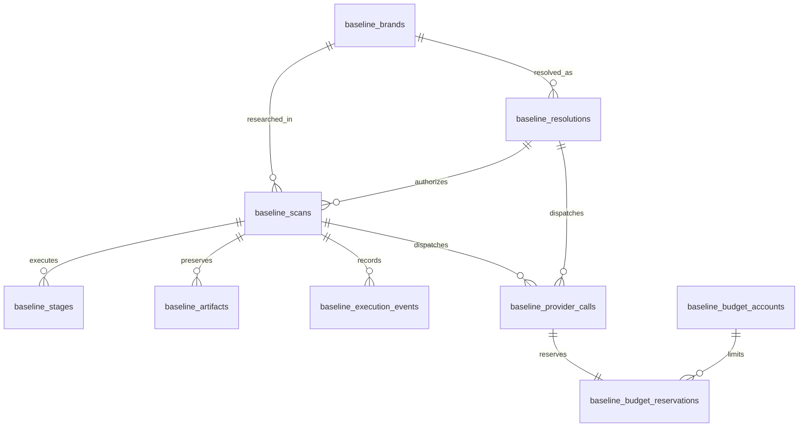

# Sprint 9B: Brand intelligence and durable infrastructure

## Executive summary and decision

The brand baseline is a deterministic workflow over the existing `QlooClient`. It resolves a verified brand, retrieves its tags and four bounded recommendation domains, projects a Cultural Fingerprint, and exposes at most five tag-grounded territory candidates. It makes **zero model calls**. A candidate is an observed association, never a relative analysis or a commercial recommendation. The existing Haiku agent, query path, and recorded Jacquemus Atlas remain separate and admission-gated.

PostgreSQL stores new baseline research. Raw, parameterized SQL and one checksum-pinned, version-controlled migration are smaller than adding an ORM to this repository. The application never auto-migrates on startup. Existing `JobManager`, `RunStore`, `QueryStore`, and `SpendLedger` remain in memory; this sprint does not make existing agent jobs crash-resumable.

## Architecture and contracts



The browser receives a resolution-scoped random access token. The Next.js proxy sends it as a header alongside the existing internal API secret and server-derived visitor identity. PostgreSQL stores only its SHA-256 hash. The proxy allowlists baseline routes and strips browser-supplied identity/auth headers. Direct backend callers without the internal secret fail before any Qloo dispatch. `CE_BASELINE_ENABLED` and `CE_BASELINE_LIVE_ENABLED` both default to off; `CE_BASELINE_TOTAL_QLOO_CALLS` defaults to zero. Existing `CE_ACCEPT_INVESTIGATIONS=0` remains unchanged.

The shared `ce-brand-baseline/0.1` result separates brand identity, signals, per-domain coverage, evidence references, territories, and execution. Every Qloo-derived finding carries operation, correlation ID, source ID, capture time, source status, and scope. A scan result is validated against recorded provider calls and stored observation artifacts before commit. No global numeric elasticity score, distance, probability, or cross-call affinity average is present.

### Data model



`baseline_brands` holds confirmed Qloo brand identity and verification time. `baseline_resolutions` holds one lookup and its possible ambiguity. `baseline_scans` carries stable ID, version, access scope, idempotency hash, status, lease, call count, and result artifact reference. `baseline_stages` and `baseline_execution_events` record progress and bounded errors. `baseline_provider_calls` records each dispatched attempt, timing, outcome, correlation ID, and uncertainty. `baseline_budget_accounts` plus reservations enforce a global call ceiling transactionally. `baseline_artifacts` holds validated, minimal JSONB observations and results. Cultural signals and territory candidates live in the versioned result artifact; their source IDs and references are preserved without two more mutable tables.

### Execution sequence

1. Resolve a name or user-selected Qloo ID with `describe(type=brand)`. Multiple candidates require confirmation; an ID must round-trip exactly. A resolution is reusable for 24 hours, after which a new lookup is required.
2. With a valid resolution and idempotency key, create one `QUEUED` scan or reuse a completed scan of the same brand and template from the last 24 hours. A cache clone records its source scan and uses zero provider calls.
3. A single worker claims a two-minute database lease and heartbeats every 30 seconds. It runs `entity_tags` and bounded `recommend` calls for artist, place, movie, and book. It records every attempt before dispatch, with at least seven seconds between baseline dispatches.
4. The workflow stores each validated observation and completes that stage in the same transaction. It then deterministically filters invalid types, duplicate IDs, operational tags, and mismatched provenance; limits each domain to ten entities; and emits at most five tag-grounded candidates.
5. Result validation checks artifact schema and call provenance before atomic completion. Polling and evidence reads never call Qloo.

The per-scan hard ceiling is seven dispatched calls **including retries**. The global durable account has a separate configured ceiling, and a completed or uncertain dispatch is never refunded. Qloo requests have no invented dollar price. The baseline has no Anthropic reservation or model dependency. The existing agent ledger is unchanged.

### Failure and recovery

All database writes use transactions and constraints. Startup checks DB connectivity when baseline admission is enabled, but does not run DDL. An unreachable database fails admission closed. Read queries do not auto-retry; writes and reservations are never blindly replayed. A stale lease becomes `INTERRUPTED`; any in-flight provider call becomes `UNKNOWN` and its reservation `UNCERTAIN`. An uncertain Qloo outcome cannot be replayed by restart. Operators can inspect `/ops/baselines` using the existing operator token; it returns counts and budget only. A restart may leave a queued scan to be picked up, while a stale running scan requires a fresh authorized request after reconciliation. This gives at-most-one local completion, **not exactly-once provider execution**.

Resolution states are `PENDING`, `RESOLVED`, `AMBIGUOUS`, `NOT_FOUND`, and `TEMPORARILY_UNAVAILABLE`. Scan states include `CREATED`, `QUEUED`, `RUNNING`, `COMPLETE`, `PARTIAL`, `NEEDS_BRAND_CONFIRMATION`, `INSUFFICIENT_EVIDENCE`, `FAILED`, `INTERRUPTED`, and `CANCELLED`; some states are reserved by the schema for later operations. A scan is not created until identity is resolved, so ambiguity currently lives in the resolution record.

## API and frontend

| Endpoint | Purpose |
| --- | --- |
| `POST /api/brands/resolve` | Qloo identity lookup; returns a confirmation list when ambiguous |
| `POST /api/brands/baselines` | Idempotent create/reuse with valid resolution and access token |
| `GET /api/brands/baselines/:id` | Authorized status, stages, result; no provider call |
| `GET /api/brands/baselines/:id/territories` | Grounded candidates; no provider call |
| `GET /api/brands/baselines/:id/evidence` | Signals and source references; no provider call |
| `GET /ops/baselines` | Operator-only DB, budget, scan, and call counts |

The Living Atlas opening page contains a small brand research panel. It supports brand entry, identity confirmation, execution status, fingerprint, and territory evidence. It shows real stage states and no invented progress percentage. The recorded Jacquemus experience stays available. The baseline currently offers `inspect_evidence`; deep investigation handoff remains for Sprint 9C/9D and must never treat candidate status as a verified agent conclusion.

## Local PostgreSQL and migration

Use PostgreSQL 16 or newer and an isolated database. Set `DATABASE_URL` in the shell or `backend/.env` (never commit it), then run:

```sh
pnpm db:migrate
pnpm test:db
pnpm smoke:baseline
```

`001_brand_baseline.sql` is additive and uses foreign keys, uniqueness, checks, and indexes. `db:migrate` takes an advisory lock, executes the SQL in one transaction, and records a SHA-256 checksum. Repeating it is a no-op. A checksum mismatch refuses startup/migration; never edit an applied migration. If deployment fails, keep the additive tables, restore the previous application revision, repair in a new forward migration, and use the last verified dump if data recovery is needed. Do not auto-reset or run ORM sync.

### Backup/export and restore drill

The local drill used PostgreSQL `pg_dump -Fc`, created a separate empty restore database, ran `pg_restore`, and compared scan/artifact/migration counts. The observed source and restore counts matched: **16 scans, 8 artifacts, 1 migration**.

The **Railway export and local restore drill passed** on 25 October. The Railway Postgres 18 custom-format dump was 27,244 bytes. It restored with `pg_restore --no-owner --exit-on-error` into an isolated local PostgreSQL 18 container. Source and restore counts matched: **1 migration, 0 scans, 0 artifacts, 0 provider calls**, and the migration checksum matched. This proves export and restore mechanics for the newly deployed empty database; it does not yet prove recovery of future research data.

For a Railway backup, run from a trusted operator machine with a registered Railway SSH public key. `railway ssh config --service Postgres --dry-run` reveals the **service instance ID** (not the service ID). The tested private export shape is:

```sh
ssh '<service-instance-id>@ssh.railway.com' 'pg_dump -Fc --no-owner -d railway' > /private/tmp/ce-backup.dump
file /private/tmp/ce-backup.dump
```

No public TCP proxy or database credential is needed in the shell command; `pg_dump` runs inside the Postgres container with its server-side environment. Check the SSH host key on first connection. For a restore drill, use a separate local PostgreSQL version matching the Railway server, copy the dump into it, run `pg_restore --no-owner --exit-on-error`, then compare migration checksum and table counts against the source. The tested drill used `postgres:18` in an isolated `--network none` Docker container and `docker cp` for the dump. Do **not** restore over the production database. Encrypt and store the final dump outside Railway before deleting resources. Restrict access and choose a retention period with the owner. The `/private/tmp` drill file is temporary and is not an archival backup.

## Railway deployment and cost control

The intended topology is the existing API service, one replica, plus **one** managed PostgreSQL service and its single data volume in the existing project and production environment. `DATABASE_URL` must be a server-side Railway reference to the Postgres private address. No public database TCP proxy, Redis, worker service, additional replica, or new frontend deployment is needed. Keep `CE_BASELINE_ENABLED=0`, `CE_BASELINE_LIVE_ENABLED=0`, `CE_BASELINE_TOTAL_QLOO_CALLS=0`, and `CE_ACCEPT_INVESTIGATIONS=0` in production until a separate release review. Apply the reviewed migration manually and test connectivity and persistence before enabling baseline admission.

Railway bills by actual resource usage. At review, the existing API's observed 24-hour maxima were about **0.008 vCPU and 0.047 GB RAM**. Use conservative limits with headroom after checking Postgres' observed usage; a hard cap that causes OOM would risk data service availability. The workspace had a **$5 soft usage alert** and **$10 hard limit**, with about **$0.014** current use. Do not lower the hard limit for a demo without confirming the resulting shutdown behavior. The Railway Hobby plan includes a monthly usage allowance; CPU, RAM, volume, and egress add usage charges per Railway's [pricing](https://docs.railway.com/pricing/plans). Record actual Postgres usage after a day before projecting ongoing cost. Keep the existing alerts and review them during the demo.

Post-hackathon shutdown: disable both baseline gates and investigation admission; export and restore-test a final encrypted PG dump; verify source/restore row counts and migration checksum; retain the dump outside Railway; then deliberately delete the Postgres service/volume and API only when the owner authorizes teardown. Removing the volume before a verified export irreversibly loses data. Railway's [PostgreSQL guide](https://docs.railway.com/databases/postgresql) and [backup guide](https://docs.railway.com/guides/postgres-backups-restores) describe private service connectivity and dump/restore.

## Validation and evaluation matrix

`pnpm eval:brand-baseline` covers pure synthetic evidence projection. `pnpm test:db` and `pnpm smoke:baseline` require a real isolated database. `pnpm test:e2e` uses a **SYNTHETIC** job API. These tests are never reported as live Qloo validation. The matrix below is an initial quality plan; “covered” identifies implemented automated checks, while “review” or “pending” flags remaining evidence needs.

| # | Scenario | Gate | State |
| ---: | --- | --- | --- |
| 1 | Unambiguous verified brand | Identity | Covered |
| 2 | Qloo ambiguity | Identity | Covered |
| 3 | Selected ID mismatch | Identity | Covered |
| 4 | Non-brand Qloo type | Identity | Covered |
| 5 | Empty brand result | Identity | Covered |
| 6 | Invalid brand name | Identity | Covered |
| 7 | Alias/case/whitespace variants | Identity | Review |
| 8 | Partial identity response | Identity | Review |
| 9 | Qloo needs_input without brand candidate | Identity | Review |
| 10 | Retryable identity failure | Provider | Review |
| 11 | Non-retryable identity failure | Provider | Review |
| 12 | Tag profile with grounded tags | Evidence | Covered |
| 13 | Operational tag exclusion | Evidence | Covered |
| 14 | Duplicate signal IDs | Evidence | Covered |
| 15 | Wrong recommendation entity type | Evidence | Covered |
| 16 | Empty tag profile | Evidence | Covered |
| 17 | Degraded recommendation | Evidence | Covered |
| 18 | All domains unavailable | Evidence | Covered |
| 19 | One available domain | Evidence | Review |
| 20 | Mismatched correlation ID | Evidence | Covered |
| 21 | Within-call rank preservation | Determinism | Covered |
| 22 | No cross-call affinity aggregation | Determinism | Covered |
| 23 | No numeric elasticity | Determinism | Covered |
| 24 | Five-candidate maximum | Determinism | Covered |
| 25 | Stable candidate identity | Determinism | Covered |
| 26 | Cross-brand generic projection | Generalization | Covered |
| 27 | Fresh migration | Durability | Covered |
| 28 | Repeated migration/checksum | Durability | Covered |
| 29 | Foreign key violation rollback | Durability | Covered |
| 30 | Concurrent same-key request | Idempotency | Covered |
| 31 | Same key with different payload | Idempotency | Covered |
| 32 | Cached result zero new calls | Budget | Covered |
| 33 | Concurrent call reservations | Budget | Covered |
| 34 | Uncertain dispatch is not refunded | Budget | Covered |
| 35 | Seven-call hard scan limit | Budget | Covered |
| 36 | Stale worker lease | Recovery | Covered |
| 37 | In-flight request becomes unknown | Recovery | Covered |
| 38 | Completed result after DB reconnect | Durability | Covered |
| 39 | Completed result after backend process restart | Durability | Covered |
| 40 | Corrupt artifact fails closed | Integrity | Covered |
| 41 | Database unavailable | Reliability | Covered |
| 42 | Direct unauthenticated POST | Security | Covered |
| 43 | Browser identity header spoof | Security | Covered |
| 44 | SYNTHETIC browser identity-to-evidence flow | Product | Covered |
| 45 | Real cultural usefulness review | User value | Pending live/human review |
| 46 | Cloud backup/restore and persistence | Durability | Pending Railway drill |

The code is general across brands; production baseline files contain no Loewe or Jacquemus pins. Deterministic fixtures use placeholder Qloo IDs under `backend/tests/fixtures/synthetic/`. A human review of a real scan is still required to judge whether its associations are useful, and a positive review would still not prove commercial opportunity.

## Controlled live Qloo canary, 25 October 2026

One Loewe canary used an isolated local PostgreSQL database and the approved seven-call ceiling. Qloo resolved `Loewe` as `urn:entity:brand`, ID `628AFDF5-16D7-4AE5-B727-AF5AE5CE12F2`, with describe correlation `mcp-9bc93549-8cab-4a1e-a067-fd45b4aa9a77`. The baseline dispatched six calls total: one describe, one `entity_tags`, and four `recommend` (artist, place, movie, book). All six provider calls settled `COMPLETE` with Qloo status `ok`. Their recorded durations were 1,449, 969, 3,759, 1,428, 1,828, and 977 ms respectively. The scan execution took 34,637 ms including required spacing. There were no recorded retries, timeouts, degraded replies, or Anthropic calls. The repeated idempotency request used **zero** new Qloo calls.

The stored tag call (`mcp-9b1ee8ab-e7f6-43ec-99fb-dd70be16b0ef`) returned ten tags, including `urn:tag:genre:media:fashion` (Fashion), `urn:tag:genre:person:model` (Model), and several operational or weakly relevant attributes such as a credit-card tag. The four recommendation calls returned ten entities each. Recorded first examples were Red Velvet/BLACKPINK/SUNMI (artist), Les Ombres/Café de la Paix/Hermès (place), Call Me by Your Name/Phantom Thread/Roma (movie), and More Than Enough/The Meaning of Mariah Carey/Big Friendship (book). These are **Qloo-returned associations**, not verified brand strategy, territory support, or commercial opportunity.

The five observation stages and validation stage completed, but the final result transaction failed and the scan became `INTERRUPTED` with `WORKER_FAILURE`. No result artifact survived database reconnect. Therefore **`QLOO_LIVE_BASELINE=FAILED`** and the product's live value gate remains open. The old worker recorded only a generic finalization error, so the exact exception cannot be proven retrospectively. A plausible failure was repeated exclusion warnings exceeding the result schema's limit; the code now coalesces repeated warnings and has a regression test, and future workers classify Zod finalization failures explicitly. Observation artifacts now preserve normalized entity type and source correlation for reproduction. The single approved canary is over; no additional provider call is assumed or claimed. Its six call records and observations remain in the local canary database for audit. A future separately approved canary must prove full result persistence and human-reviewed usefulness.

The Railway template provisioned exactly one Postgres service, one replica, and one 5 GB volume in the existing project, with no public TCP proxy. Both the Postgres and original API service reported online with no active issues. After migration, Postgres used about 0.074 GB RAM, 0.153 GB disk, and less than 0.005 vCPU at the sampled peak; its resource limits were set to 1 GB RAM and 1 vCPU with headroom. The existing API already had 1 GB RAM and 0.5 vCPU limits. Its `DATABASE_URL` is a server-side reference to `Postgres.DATABASE_URL`; `CE_BASELINE_ENABLED=0`, `CE_BASELINE_LIVE_ENABLED=0`, `CE_BASELINE_TOTAL_QLOO_CALLS=0`, and `CE_ACCEPT_INVESTIGATIONS=0` were set without redeploying the running API. The reviewed additive migration ran over a temporary private SSH tunnel: `BASELINE_MIGRATIONS_OK applied=1`. Its durable migration row and checksum were present in the exported and restored database.

The Sprint 9B branch was pushed at `a3076c7a3c690081e998987bc5c0eea22afb2c14`. A source change to that commit was staged for the existing production API service. Automatic approval review initially rejected applying it because the repo's release policy required explicit production release authorization; the owner then gave that authorization and the staged patch was applied. The new deployment `052129e5-1c9e-4791-8fc2-3ebcf0e55056` reached `SUCCESS`, one running replica, no Railway issues. Railway's source configuration still shows the `a3076c7` pin, but both the deployment metadata and `/ops/status` report the actual built revision as `fad3ba7b481d91bb57b372c7fbcd80a86b69f082`, the branch head at deployment time. The only difference between those commits is this verification document; application code is identical. Treat the **actual deployed SHA** as `fad3ba7` and do not assume the configured pin controlled source checkout.

Hosted verification passed after the API process replacement: `/health` HTTP 200; operator-only `/ops/baselines` returned `databaseReady=true`, one durable migration, zero Qloo calls, and both baseline flags false; unauthenticated baseline POST returned 401; authenticated POST returned 503 while paused. Existing agent admission remained paused. The repository's no-provider-call remote smoke passed **23/23**. The migration row remained readable after the API redeploy, proving hosted DB connectivity and persistence across that process replacement. No completed cloud scan exists, so cloud scan durability is not claimed. Both API and Postgres remain online. No Anthropic or Qloo call was made by hosted checks.

Pushing the development branch created two Vercel preview deployments. The latest preview returned HTTP 401 to an anonymous protection probe; the production alias returned HTTP 404 `DEPLOYMENT_NOT_FOUND`. No public frontend release occurred.

At the final cost check, workspace usage was about **$0.022** in the current billing period, with the existing $5 soft alert and $10 hard cap, below both thresholds. The hard cap can stop workloads, so it was not lowered for the demo. Postgres is a single instance with one 5 GB volume; actual ongoing cost needs a full day of observed usage before estimating a run rate.

Existing agent readiness stays `AGENT_MODEL_NOT_READY`. Credential rotation remains required before public release if the prior Railway CLI exposure cannot be safely ruled out; this sprint does not expose or print current keys.
